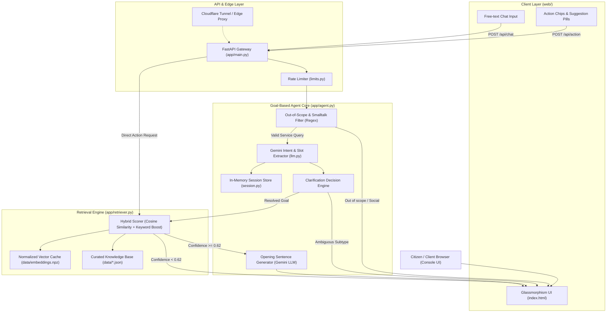
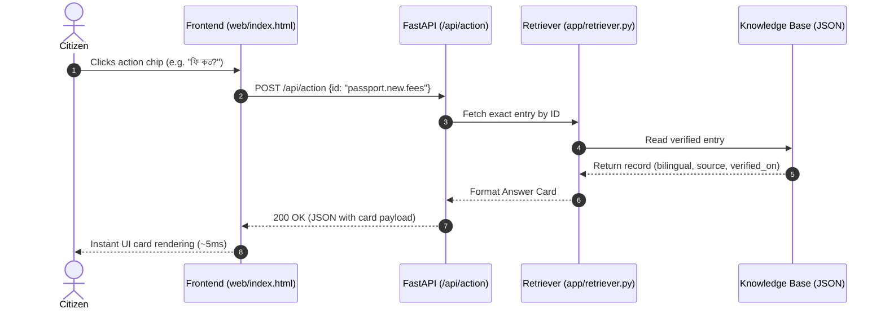
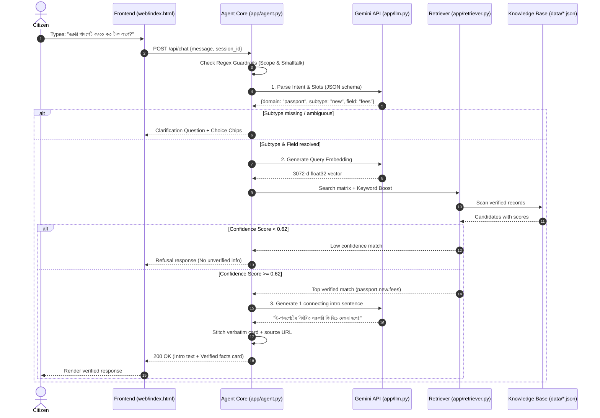

# System Architecture — সেবা সহায়ক (Seba Sohayok)
**Government Service Assistant — Goal-Based AI Agent (RAG Architecture)**  
*CSE 3202: Artificial Intelligence Sessional, BAUST*

---

## 1. Executive Summary & Design Philosophy

**Seba Sohayok** is a goal-based conversational agent designed to guide Bangladeshi citizens through public administrative services (specifically **Passport** and **Driving Licence** procedures). 

Traditional conversational chatbots rely on single-turn pattern matching or generative LLM prompting that is prone to hallucination—inventing official fees, incorrect office jurisdictions, or outdated requirements. **Seba Sohayok** enforces three foundational architectural rules:

1. **Zero Fact Hallucination:** The Large Language Model (Gemini) is strictly forbidden from outputting numerical fees, office names, deadlines, or required documents. All factual bodies are served verbatim from a curated, human-verified Knowledge Base (`data/*.json`).
2. **Confidence-Gated Refusal:** A semantic search scoring below the threshold (`CONF_THRESHOLD = 0.62`) triggers an explicit refusal rather than speculative generation.
3. **Bimodal Execution (Fast-Path vs. Generative Path):** Structured interactions (chip clicks) bypass the LLM entirely, yielding deterministic sub-10ms response times. Unstructured text flows through an intent-and-slot extraction pipeline with conversational clarification.

---

## 2. High-Level System Architecture



---

## 3. Core Component Breakdown

### 3.1 Interface Layer (`web/`)
- **`index.html`**: Zero-dependency single-page console built with modern semantic HTML5 and vanilla JavaScript. Features a glassmorphism aesthetic with automatic dark/light mode detection (`prefers-color-scheme`).
- **`admin.html`**: Restricted-access management portal for human-in-the-loop document ingestion, pending review, and staleness monitoring.

### 3.2 Routing & Edge Control (`app/main.py`, `app/limits.py`)
- **FastAPI Application**: Asynchronous ASGI framework providing OpenAPI documentation (`/docs`), automated Pydantic schema validation, and health checks (`/health`).
- **In-Memory Rate Limiting**: Per-IP sliding-window algorithm enforcing quotas (`RATE_PER_MIN = 20`, `RATE_PER_DAY = 200`) without external Redis dependency.

### 3.3 Goal-Based Agent Core (`app/agent.py`)
The conversational agent is framed around goal resolution rather than simple reflex response:
- **Environment & State**: Operates over a session state (`session.py`) tracking `(domain, subtype, slots, lang)`.
- **Pre-LLM Gatekeeping**:
  - `OUT_OF_SCOPE`: Deterministic regex patterns intercept queries regarding Land Records, NID, Birth Certificates, and Tax before invoking LLMs.
  - `SMALLTALK`: Intercepts greetings, identity inquiries, and acknowledgments to preserve quota.
- **Clarification Loop**: If the citizen specifies a domain (e.g., "পাসপোর্ট") but omits the subtype (New, Re-issue, Correction, Lost), the agent halts retrieval and responds with a multi-choice clarification chip set.

### 3.4 Hybrid Retrieval Engine (`app/retriever.py`)
- **Direct NumPy Vector Search**: Because the curated knowledge base contains ~70 highly structured domain entries, an approximate nearest neighbor (ANN) database (such as FAISS or Chroma) would introduce cold-start latency and binary packaging bloat. A vectorized cosine similarity scan across `data/embeddings.npz` runs in **< 1 ms**.
- **Scoring Function**:
  $$\text{Score}(q, d) = \cos(\mathbf{e}_q, \mathbf{e}_d) + \beta \cdot \text{KeywordBoost}(q, d)$$
  Where:
  - $\mathbf{e}_q$: 3072-dimensional normalized embedding vector of the query (via `gemini-embedding-001`).
  - $\mathbf{e}_d$: Pre-calculated document embedding vector.
  - $\beta$: Weight multiplier for exact matches against multilingual keywords (Bangla, English, Banglish).
- **Threshold Gating**: Top candidate score must exceed `CONF_THRESHOLD = 0.62`; otherwise, the refusal response triggers.

### 3.5 LLM Integration (`app/llm.py`, `app/prompts.py`)
- Communicates with Google Gemini models using the official `google-genai` SDK.
- **Structured JSON Mode**: Extracts `{"domain": "...", "subtype": "...", "field": "..."}` strictly bounded by schema.
- **Surface Generation**: Gemini is restricted to synthesizing a single introductory sentence in the citizen's detected language, followed by the verbatim rendering of the official facts card.

---

## 4. Execution Sequence Diagrams

### 4.1 Fast-Path (Action / Chip Click: ~5 ms)



### 4.2 Free-Text Reasoning & RAG Retrieval Flow



---

## 5. Knowledge Base & Data Contract

Each atomic domain entry in `data/passport.json` and `data/licence.json` satisfies the following JSON schema:

```json
{
  "id": "passport.new.fees",
  "domain": "passport",
  "subtype": "new",
  "field": "fees",
  "title_bn": "ই-পাসপোর্ট ফি ও বিতরণ সময়",
  "title_en": "e-Passport Fees & Delivery Timeframe",
  "content_bn": "৪৮ পৃষ্ঠা ৫ বছর মেয়াদ: নিয়মিত ৪,০২৫ টাকা, জরুরি ৬,৩২৫ টাকা...",
  "content_en": "48 pages 5 years: Regular 4,025 BDT, Urgent 6,325 BDT...",
  "source_url": "https://www.epassport.gov.bd/instructions/passport-fees",
  "verified_on": "2026-09-18",
  "keywords": ["ফি", "টাকা", "খরচ", "fee", "cost", "taka", "khoroch", "urgent"]
}
```

### Human-in-the-Loop Admin Workflow (`/admin`):
1. **Raw Ingestion**: Officer pastes new gazette or PDF text.
2. **Draft Synthesis**: Gemini structures the text into proposed entries (`data/pending.json`).
3. **Verification**: Officer reviews facts against official portal, inputs `source_url` and `verified_on`.
4. **Approval & Re-indexing**: Commit writes to `data/*.json` and calls `retriever.build_index()` to recalculate embeddings.

---

## 6. AI Agent Characteristics (Russell & Norvig PEAS Formulation)

| Dimension | Specification |
|---|---|
| **Performance Measure (P)** | Zero factual error rate, retrieval precision at threshold $\ge 0.62$, sub-second turn latency, high citizen completion rate. |
| **Environment (E)** | Web browser client, asynchronous REST API, curated government knowledge base. |
| **Actuators (A)** | JSON HTTP responses, structured conversational action chips, verified answer cards, bilingual natural language explanations. |
| **Sensors (S)** | Incoming HTTP POST requests containing user text tokens, session cookies, and action payload identifiers. |
| **Environment Properties** | Partially observable, single-agent, sequential, discrete, static within turn, mostly deterministic. |
